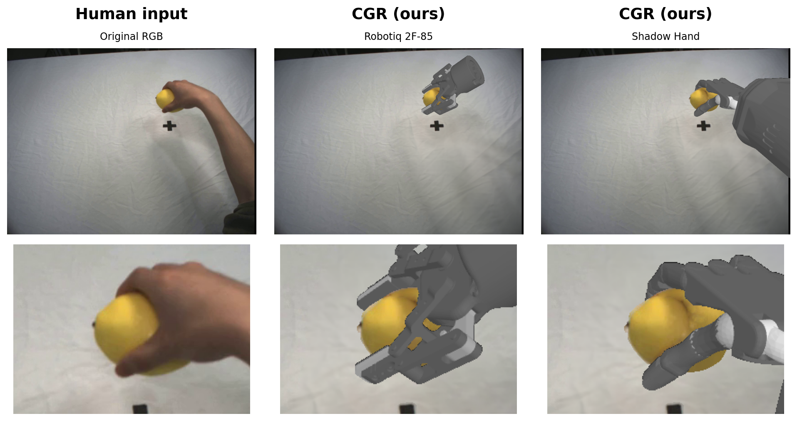
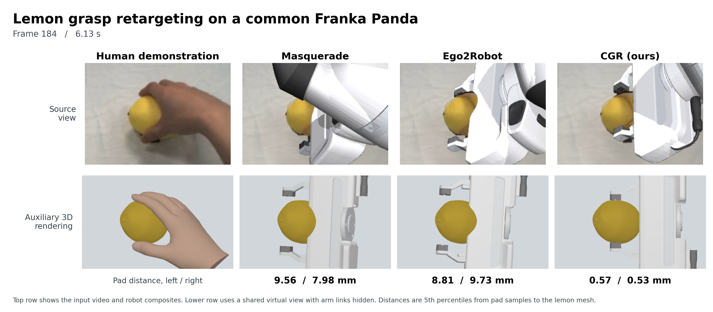

# 접촉 정보를 이용한 사람 파지 영상의 이종 로봇 손 리타게팅

*Contact-Guided Retargeting of Human Grasp Videos Across Robot Hand Morphologies*

저자 및 소속 기입 전 · 국문 원고 초안

## 초록

사람이 물체를 잡는 동작을 로봇으로 옮길 때, 사람의 엄지와 검지 궤적을 따라가더라도 로봇 손가락의 길이와 패드 두께에 따라 손끝과 물체 사이에 틈이 생길 수 있다. 본 연구에서는 사람 손과 물체의 3차원 형상에서 접촉 후보를 추정하고, 해당 영역에 로봇 손가락 표면이 가까워지도록 손의 자세와 구동값을 구한다. HRDexDB의 레몬 파지 영상 한 편을 대상으로 같은 장면을 2지 그리퍼와 5지 손으로 변환한 결과를 제시한다. 별도로 로봇과 카메라 조건을 Franka Panda로 통일하고 세 방법의 패드 배치를 비교했다. 엄지와 검지의 접촉 후보가 함께 있는 62개 프레임에서, 양 패드 중 더 먼 쪽의 표면 근접 거리는 중앙값 기준으로 CGR 0.73 mm, Masquerade 7.66 mm, Ego2Robot 7.12 mm였다. 이 결과는 주석된 레몬 형상에 대한 배치를 설명하며, 실제 파지 및 들어 올리기 성공률은 후속 평가 대상으로 둔다.

**주제어**　파지 리타게팅, 로봇 손, 손–물체 접촉, 사람 시연 영상

## 1. 서론

같은 레몬을 사람은 엄지와 여러 손가락으로 감싸고, 평행 그리퍼는 두 패드 사이에 끼운다. 이때 사람 손끝과 로봇 손끝을 같은 좌표에 놓는 것만으로는 실제로 물체를 향하는 로봇 표면의 위치가 정해지지 않는다. 손가락이 물체의 어느 쪽에 얼마나 가까이 배치되는지가 리타게팅 결과를 해석하는 기준이 된다.

본 연구는 DexStitch의 접촉 인지형 로봇 영상 합성에서 **손–물체 기하를 이용한 리타게팅**에 초점을 맞춘다 [1]. 사람 손에서 정한 접촉 후보를 형태가 다른 로봇 손에 전달하는 과정과, 같은 로봇을 사용했을 때 그 정보가 손끝 배치에 어떻게 나타나는지 기술한다. 비교 범위는 주석이 제공되는 사람 시연을 로봇 자세로 변환하고 영상에 합성하는 단계까지다.

## 2. 관련 연구

DexMV는 사람 손과 물체의 3차원 자세를 복원하고 사람 손과 로봇 손 사이의 손가락 배치를 대응시켰다 [2]. ContactOpt는 손과 물체의 접촉 분포를 이용해 사람 손의 추정 자세를 보정했다 [3]. 본 연구에서 접촉 후보는 로봇 손가락이 접근할 물체 영역을 지정하는 데 쓰인다.

Masquerade와 Ego2Robot은 사람의 손 동작을 로봇의 말단 자세와 그리퍼 명령으로 변환하여 사람 영상을 로봇 시연으로 합성한다 [4, 5]. 본 비교에서는 두 연구의 공개 동작 변환기를 사용하고, 세 방법의 출력을 같은 Panda에 적용했다. 원본 시점과 보조 시점을 함께 제시하는 구성은 손–물체 복원 결과를 비교한 Ye 등과 로봇 손의 파지 자세를 두 시점에서 비교한 Wu 등의 시각화 방식을 따른다 [6, 7].

## 3. 방법

### 3.1 사람 손에서 물체 표면의 접촉 후보 추출

각 프레임에서 HRDexDB의 오른손 MANO 메시와 물체 메시, 물체의 6자유도 자세, 카메라 보정값을 읽는다 [8, 9]. 손 메시 정점을 물체 좌표계로 변환하고, 물체의 볼록 껍질까지의 거리가 기본값 6 mm 이내이거나 껍질 내부에서 보정된 정점을 접촉 후보로 삼는다. 각 후보에 가장 가까운 껍질 표면점을 대응시키고 손가락별로 모은다. 이 절차는 촉각 센서 없이 주석된 형상에서 파지 위치의 단서를 얻는다.

### 3.2 로봇 손 자세와 구동값 결정

로봇마다 사용할 손가락과 대응하는 사람 손가락을 지정한다. 평행 그리퍼는 엄지와 검지가 이루는 축을, 여러 손가락을 가진 손은 해당 모델의 손끝 또는 손바닥 기준점을 이용해 초기 방향을 정한다. 이어서 로봇 고유의 구동 범위 안에서 구동값과 손 기준점의 병진 보정을 함께 최적화한다. 목적함수에는 사람과 로봇의 손끝 위치 오차, 접촉 후보와 해당 로봇 손가락 표면 사이의 거리, 물체 충돌 대리 형상에 대한 침범 비용, 이전 프레임 구동값과의 차이 및 병진 보정량이 들어간다. 세계 좌표계에서 손 자세를 평활화한 뒤 표본점의 침범 깊이를 다시 계산한다.

공개 모듈은 Robotiq 2F-85, Shadow DEX-EE, LEAP Hand, Shadow Hand의 구동 및 관절 구조를 지원한다. 그림 1은 그중 2지와 5지 손에 같은 프레임을 대응시킨 예다. 원본 카메라에 로봇 손을 합성할 때에는 로봇과 물체의 깊이를 비교해 앞뒤 관계를 정한다.

**그림 1.** HRDexDB 레몬 시연의 100번 프레임(3.33초). 왼쪽에서부터 사람 손, Robotiq 2F-85, Shadow Hand를 보인다. 아래 행은 같은 화면의 확대 영역이다. 두 로봇 결과는 각 손의 고유 관절 구조로 구한 자세를 원본 시점에 합성한 것이다.

## 4. 실험과 결과

### 4.1 비교 조건 및 지표

프레임 번호는 0부터 센다. HRDexDB의 레몬 에피소드 0, 카메라 25452062에서 30 Hz의 231개 프레임을 사용했다. 공통 로봇 비교에는 별도의 Panda 어댑터를 적용했다. 세 방법 모두 같은 사람 손 관절 궤적을 바탕으로 하며, 같은 Panda 모델, 로봇 베이스, 역기구학 해법, 카메라 및 물체 자세로 출력했다. Masquerade와 Ego2Robot은 공개 변환기로 짝수 프레임을 15 Hz에서 처리한다. CGR은 30 Hz로 전체 궤적을 처리하며 등록된 물체 형상과 자세, 사람 손의 추정 접촉 후보를 추가로 이용한다. 따라서 비교 대상은 이 조건에서 얻은 세 방법의 **말단 배치**다.

0∼230번의 짝수 프레임 중 사람 엄지와 검지의 접촉 후보가 동시에 있고 영상에서 레몬이 보이는 62개를 평가했다. 각 Panda 패드 안쪽 표면에 면적을 따라 512개 점을 표본화했다. 각 점에서 원래 레몬 삼각형 메시까지의 최단거리를 구한 뒤, 한 표본점의 우연한 근접에 좌우되지 않도록 거리의 5백분위수를 해당 패드의 근접 거리로 정의했다. 양쪽 패드가 모두 가까워야 작은 값이 나오도록, 프레임 지표로는 왼쪽과 오른쪽 값 중 큰 값을 사용했다. 레몬 메시는 열린 표면이므로 거리에는 부호가 없다.

### 4.2 패드가 레몬에 얼마나 가깝게 배치되는가

**표 1.** 공통 Panda의 패드–레몬 거리(mm). 가운데 두 열은 그림 2의 한 프레임에서 구한 값이다. 마지막 열은 각 프레임에서 두 패드 중 큰 값을 먼저 구한 뒤 전체 62개에서 중앙값을 취한 값이다.

| 방법 | 184번 왼쪽 | 184번 오른쪽 | 62개 프레임 중앙값 |
| --- | ---: | ---: | ---: |
| Masquerade | 9.56 | 7.98 | 7.66 |
| Ego2Robot | 8.81 | 9.73 | 7.12 |
| CGR | **0.57** | **0.53** | **0.73** |

**그림 2.** 184번 프레임(6.13초)의 사람 시연과 공통 Panda 비교. 위 행은 사람의 원본 RGB와 세 로봇 합성 영상이다. 아래 행은 같은 손과 물체 자세를 하나의 가상 직교 카메라로 본 결과다. 보조 카메라의 방향은 사람 엄지 끝·검지 끝·손목이 이루는 평면에 수직이며, 로봇의 근위 팔 링크를 세 방법 모두에서 숨겨 패드와 레몬 사이를 보이게 했다.

그림 2는 CGR의 양쪽 패드가 일관되게 더 가깝게 배치된 모습을 보여주기 위해 골랐다. 각 프레임에서 같은 쪽 패드를 두 비교 방법과 각각 대조해 네 개의 거리 차이를 구하고, 그중 가장 작은 차이가 최대인 프레임을 택했다. 184번에서는 이 차이가 7.45 mm였다. CGR의 안쪽 패드 표본 중 레몬에서 3 mm 이내인 비율은 왼쪽 39.3%, 오른쪽 38.1%였고, 두 비교 방법은 양쪽 모두 0%였다. 두 패드의 거리 차이는 가상 카메라의 투영 영상과 독립적으로 3차원 형상에서 계산했다.

## 5. 논의 및 결론

이 레몬 시연에서는 사람 손에서 추정한 접촉 영역을 목적함수에 포함한 CGR이 로봇의 양쪽 패드를 물체 표면에 가깝게 배치했다. 같은 장면을 서로 다른 로봇 손으로 합성한 그림은 형태 간 대응을 보여주고, 공통 Panda 비교는 대상 로봇의 크기와 카메라가 바뀔 때 생기는 시각적 차이를 줄여 준다.

다만 CGR은 맞춤 과정에서 레몬 형상을 직접 이용하며 비교 방법과 입력 및 시간 전처리가 다르다. 현 비교에서 방법 간 차이 전체를 접촉 항 하나의 효과로 분리할 수 없다. 또한 62개 프레임은 하나의 연속 시연에서 나온 반복 관찰이다. 레몬까지의 부호 없는 거리는 표면 근접도를 나타낸다. 실제 접촉을 평가하려면 ContactPose의 열영상과 같이 자세 추정과 독립된 관측이 필요하다 [10]. 다음 실험에서는 동일한 입력과 초기 자세에서 접촉 항만 제거한 CGR과 비교하고, 여러 물체와 독립 시연에서 같은 지표를 집계할 필요가 있다. 들어 올린 뒤 물체를 유지하는지에 대한 평가는 기하 지표와 분리해 수행한다.

## 참고문헌

1. B. Choi et al., *DexStitch: Learning and Composing Dexterous Skills from Human Videos via Contact-Aware Robotic Inpainting*, arXiv:2610.17789, 2026. [원문](https://arxiv.org/abs/2610.17789)
2. Y. Qin et al., *DexMV: Imitation Learning for Dexterous Manipulation from Human Videos*, ECCV, 2022. [원문 Fig. 4](https://arxiv.org/pdf/2108.05877#page=8)
3. P. Grady et al., *ContactOpt: Optimizing Contact To Improve Grasps*, CVPR, 2021. [원문](https://openaccess.thecvf.com/content/CVPR2021/html/Grady_ContactOpt_Optimizing_Contact_To_Improve_Grasps_CVPR_2021_paper.html)
4. M. Lepert, J. Fang, J. Bohg, *Masquerade: Learning from In-the-wild Human Videos using Data-Editing*, ICRA, 2026. [저자 프로젝트](https://masquerade-robot.github.io/)
5. Y. Wang et al., *Ego2Robot: Scalable Robot Data Synthesis from Egocentric Human Data*, arXiv:2608.02580, 2026. [원문](https://arxiv.org/abs/2608.02580)
6. Y. Ye, A. Gupta, S. Tulsiani, *What's in Your Hands? 3D Reconstruction of Generic Objects in Hands*, CVPR, 2022. [원문 Fig. 3](https://openaccess.thecvf.com/content/CVPR2022/papers/Ye_Whats_in_Your_Hands_3D_Reconstruction_of_Generic_Objects_in_CVPR_2022_paper.pdf#page=5)
7. Z. Wu et al., *DiffMorphGrasp: A Diffusion Framework Conditioned on Hand Morphology for Cross-Embodiment Grasp Generation*, CoRL, 2026. [원문 Fig. 11](https://arxiv.org/html/2602.00915v2#A5.F11)
8. J. Lim et al., *HRDexDB: A 4D Dexterous Grasping Dataset Across Human and Multiple Robot Embodiments*, arXiv:2604.14944, 2026. [저자 프로젝트](https://snuvclab.github.io/HRDexDB/)
9. J. Romero, D. Tzionas, M. J. Black, *Embodied Hands: Modeling and Capturing Hands and Bodies Together*, ACM Transactions on Graphics, 2017. [원문](https://doi.org/10.1145/3130800.3130883)
10. S. Brahmbhatt et al., *ContactPose: A Dataset of Grasps with Object Contact and Hand Pose*, ECCV, 2020. [원문](https://arxiv.org/abs/2007.09545)

그림 1·2의 사람 영상과 물체 형상 출처는 Jongbin Lim 등의 HRDexDB이다. 해당 자료를 잘라 쓰고 로봇과 물체를 렌더링·합성했다. [데이터 카드](https://huggingface.co/datasets/HRDexDB/HRDexDB) · [CC BY-NC 4.0](https://creativecommons.org/licenses/by-nc/4.0/)
